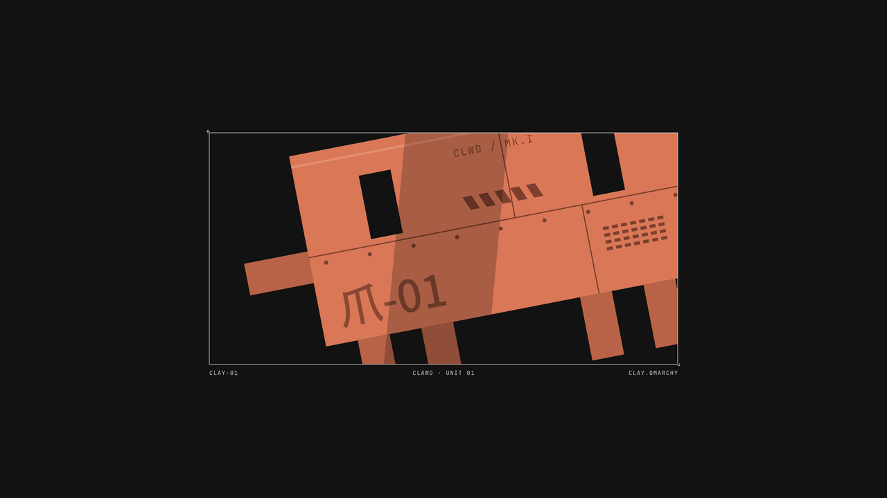

# clay.omarchy

灰阶为底，陶土色点睛的 [Omarchy](https://omarchy.org/) 主题，提供暗色 `clay` 与亮色 `clay-light` 两个变体。与 [clay.nvim](https://github.com/DefectingCat/clay.nvim) 和 clay.omp 使用同一套设计语言：安静的中性灰表面、分层文字、克制的 `#d97757` 交互焦点。色值与语义以 clay.nvim 的 [Clay 设计规范](https://github.com/DefectingCat/clay.nvim/blob/master/design/clay-design-system.md)为准。



*Clawd Unit：随主题分发的默认壁纸缩略图，不是桌面效果截图。*

## 主题范围

- **Hyprland**：陶土色活动窗口／分组边框，灰色非活动边框。
- **Omarchy Shell**：与 Solitude 一样直接使用系统模板；状态栏、菜单、启动器、通知、锁屏、弹出层与工具提示均从 `colors.toml` 派生，不维护静态分区配色。
- **终端**：Ghostty、Alacritty、Kitty、Foot 共用设计规范的 ANSI 色板（灰阶，red 为 Clay）、正文和选区，通过 Omarchy 自带模板生成。
- **应用**：由本机模板生成 btop、Helix、Neovim/Aether、VS Code、Obsidian、浏览器、Pi 等配色。是否写入应用、是否即时重载由 Omarchy 自身及应用安装情况决定。
- **tmux**：Omarchy 的原生主题切换钩子同步窗口前景／背景、光标、面板色板与主题环境变量；不定制状态栏、窗口标签或面板边框。
- **图标**：暗色 `Yaru-wartybrown-dark`、亮色 `Yaru-wartybrown`，使用 Omarchy 常见的 Yaru 图标包，不下载额外图标。
- **壁纸**：每个变体各 5 张 3840×2160 Clawd 壁纸（见下文），只用对应变体的 Clay 色板。

主题本身不修改按键、显示器、窗口规则、字号、用户 Shell 布局或空闲锁屏策略。Shell 尺寸与字体缩放跟随 Omarchy 默认模板；可选的全局圆角配置见下文。

### Clawd 壁纸系列

`backgrounds/02`–`06`（暗色）与 `light/backgrounds/02`–`06`（亮色）参照 [TYPE-17](https://github.com/atif-1402/omarchy-type17-theme) 的构图：纯色底、居中细线画框、框下三段小字，画面以 Claude 的像素吉祥物 Clawd 为主角，只用 Clay 色板。由 `scripts/clawd_wallpapers.py --variant dark|light` 生成，均为 3840×2160。

| 文件 | 画面 |
| --- | --- |
| `02-clawd-unit.png` | 倾斜放大的机甲面板 Clawd，被画框裁切 |
| `03-clawd-schematic.png` | 工程图：网格、像素轮廓、尺寸与部件标注 |
| `04-clawd-horizon.png` | Clay Horizon 山脊顶上的小 Clawd |
| `05-clawd-terminal.png` | 终端欢迎页式的方块字 Clawd 与提示符 |
| `06-clawd-march.png` | 满框灰色 Clawd 中唯一的陶土色一只 |

切换主题时默认取 `backgrounds/` 中的第一张；用 `omarchy theme bg next` 轮换，或 `omarchy theme bg set` 指定。Clawd 是 Anthropic 的吉祥物，本系列为非官方同人重绘，与 Anthropic 无关联。

## 兼容性

面向 **Omarchy 4.0.6 的 `colors.toml` 主题接口**，使用当前版 Omarchy 的模板生成与应用配色钩子；不承诺旧版 Waybar/Walker/Hyprlock 独立配置的适配。

从 Git 安装的主题不能直接覆盖会自动加载的 Lua、终端启动配置或 `vscode.json`。本项目让 Omarchy 从色板生成这些配置，因此本地工作副本和仓库克隆使用相同的配色入口；`extras/rounded.lua` 只是手动启用的圆角配置片段，不会由主题安装器自动执行。

### 共享配色机制

`colors.toml` 是运行时配色的唯一源文件，与 Solitude 使用同一套 Omarchy 原生生成流程。修改色板后重新执行 `omarchy theme set <安装名>`，由系统重新生成配置并调用应用同步钩子，不需要修改各应用的生成文件。

- Shell 主表面和文字使用 `background` / `foreground`；普通控件焦点与选中状态按系统模板使用正文色。
- 菜单／启动器的选中文字使用 `accent`；弹出层与工具提示边框引用 Hyprland 边框，通知和锁屏也跟随共享色板。
- 状态栏注意色和终端搜索的当前匹配使用 `red` 语义槽；按设计规范的终端色表，它是 Clay。
- `accent`、`hyprland_active_border`、`active_border_color` 与 `active_tab_background` 是不同语义字段；需要统一强调色时，在同一份色板内同步修改，不支持字段间变量引用。
- 不复制 Solitude 独立指定的 Ashen / Noctokai；Neovim、VS Code、btop 继续使用 Clay 色板生成的系统主题。
- 不提供 `ll` 别名、`LS_COLORS` 或 eza 专用主题。目录列表中使用 ANSI 索引色的部分会随终端色板变化，硬编码真彩色不受此机制控制。

相较旧版 Clay，移除了四份静态 `shell.*.toml`：普通控件焦点不再强制陶土色，浮层不再固定使用 `#1a1a1a` 背景与 `#444444` 边框。这是对齐原生共享配色的有意变化。

## 安装

### 从本地项目安装

在项目根目录执行；只用一个变体时只建对应的链接：

```bash
mkdir -p ~/.config/omarchy/themes
ln -s "$PWD" ~/.config/omarchy/themes/clay
ln -s "$PWD/light" ~/.config/omarchy/themes/clay-light
omarchy theme set clay        # 或：omarchy theme set clay-light
```

链接不加 `-f`，避免覆盖已有目录。工作副本所在磁盘必须保持挂载。修改项目后再次运行 `omarchy theme set clay` 或 `clay-light` 应用；不要直接修改 `~/.local/state/omarchy/current/theme/` 中的生成结果。

应用会更换背景、刷新终端和桌面配色，并调用 Omarchy 正常的应用适配钩子。建议先记下当前主题和壁纸：

```bash
omarchy theme current
readlink -f ~/.local/state/omarchy/current/background
```

### 从其他位置克隆安装

将 Git 克隆放在主题目录下即可，无需依赖本项目原始开发路径；亮色变体从克隆中的 `light/` 链接：

```bash
git clone /path/to/clay.omarchy ~/.config/omarchy/themes/clay.omarchy
ln -s ~/.config/omarchy/themes/clay.omarchy/light ~/.config/omarchy/themes/clay-light
omarchy theme set clay.omarchy   # 或：omarchy theme set clay-light
```

发布为远端仓库后，也可将其实际 URL 传给 `omarchy theme install`。该命令会立即应用主题，且会删除同名已安装目录；不要用它覆盖有本地修改的克隆。仓库名为 `clay.omarchy` 时，自动安装的主题名也是 `clay.omarchy`，不是 `clay`；它只安装暗色，亮色仍需按上面建立 `clay-light` 链接。

应用暗色时 Omarchy 会把仓库目录（包括 `light/`）复制进当前主题目录，这是 Omarchy 的通用行为，不影响生效的配色和壁纸。

### 回退与卸载

本机原先的主题为 Solitude；回退示例：

```bash
omarchy theme set solitude
# 如需保留自己选过的壁纸，再用先前记录的绝对路径恢复：
omarchy theme bg set /absolute/path/to/previous-background.png
```

切换主题后，若使用上述本地链接安装，可用 `unlink ~/.config/omarchy/themes/clay` 和 `unlink ~/.config/omarchy/themes/clay-light` 仅移除链接。不要对真实克隆目录使用 `unlink`；需保留工作目录时先移出主题目录。

## 可选：统一圆角

[`extras/rounded.lua`](extras/rounded.lua) 提供 **12px 窗口圆角**与 `rounding_power = 2.0`。Omarchy Shell 的共享 `Style.cornerRadius` 会读取 Hyprland 的 `decoration:rounding`，菜单、面板、输入框、下拉框、通知和支持共享样式的按钮随之变圆；开关自动使用胶囊形。不需要复制或修改系统 Shell。

在项目根目录执行以下操作，**只添加一次**；若已有同一段配置，不要重复追加：

```bash
cp ~/.config/hypr/looknfeel.lua ~/.config/hypr/looknfeel.lua.before-clay-rounded
cat extras/rounded.lua >> ~/.config/hypr/looknfeel.lua
hyprctl reload
hyprctl configerrors
# 刷新 Shell 的共享圆角值，但不更换当前壁纸：
omarchy theme refresh
```

这是用户级 **全局外观偏好**，切换到其他配色主题后仍保留，也不依赖本项目路径。回退时移除 `looknfeel.lua` 中标记为 `Clay rounded profile` 的 `hl.config` 代码段，再重载 Hyprland、刷新主题；不要覆盖其后新增的其他个人设置。

少数系统控件仍把方角写死，例如通用按钮提示框与确认对话框的按钮；应用内部自行绘制的控件也不受这个全局值控制。本项目保留这些系统实现，不维护 Shell 分支、不修改 `/usr/share/omarchy/`。

## 配色

| 角色 | 暗色 | 亮色 | Omarchy 字段 |
| --- | --- | --- | --- |
| 主背景 | `#121212` | `#f6f6f6` | `background`（设计规范 `bg`） |
| 侧栏表面 | `#101010` | `#f8f8f8` | `dark_background` / `darker_background`（`sidebar`） |
| 浮层表面 | `#1a1a1a` | `#ebebeb` | `lighter_background`（`float`） |
| 选区 | `#363636` | `#c6c6c6` | `selection` / `selection_background`（`selection`） |
| 非活动边框 | `#2a2a2a` | `#d5d5d5` | `hyprland_inactive_border`（`border`） |
| 正文 | `#cccccc` | `#333333` | `foreground`（`fg`） |
| 强调文字 | `#e6e6e6` | `#202020` | `bright_foreground` / `selection_foreground`（`bright`） |
| 次级文字 | `#aaaaaa` | `#4b4b4b` | `light_foreground`（`secondary`） |
| 弱化文字 | `#8e8e8e` | `#616161` | `dark_foreground`（`muted`） |
| 注释 | `#7a7a7a` | `#737373` | `muted`（`comment`） |
| 强调色 | `#d97757` | `#d97757` | `accent`、活动边框、`red` / `bright_red` |

`red`、`green`、`yellow` 等是 Omarchy 的语义槽名，本主题按设计规范的终端色表填写：除 `red` / `bright_red` 为 Clay 外都是灰阶。错误、警告、成功和 Diff 需结合图标、文字与 `+` / `-` 辨别，不能只依赖颜色。

### Omarchy 模板带来的偏差

- 终端 ANSI 0 / 7 / 8 / 15 由模板固定为 `background` / `foreground` / `muted` / `bright_foreground`。暗色与设计规范一致；亮色里 black 是底色、white 是正文，而设计规范的亮色终端表是 black 取正文色、white 取浅灰。
- 同一个 `red` 槽也被 VS Code、Helix 等应用模板用作错误色，因此这些应用的错误显示为 Clay，而设计规范的诊断表用灰阶。终端色表优先，因为终端直接使用这些槽。
- 亮色下 Clay 与底色的对比度只有 2.9：品牌色在两个变体中保持不变，这是设计规范记录的取舍。

### 与 Neovim / omp 的关系

- 不嵌入或复制 `clay.nvim` 插件。Omarchy 默认生成 Aether 的 Neovim 配色，不能承诺与 Clay 的 Tree-sitter/LSP 定义／调用高亮完全一致。要精确匹配，请在自己的 Neovim 配置中继续启用 `DefectingCat/clay.nvim`；它跟随 `background` 切换暗色与亮色。
- Omarchy 生成的终端光标使用 `bright_foreground`，因此是强调灰，而不是 Clay；不通过被仓库安装禁止的终端配置绕过这一规则。
- 终端 red 为 Clay，与 clay.nvim 内置终端色板一致。
- 不修改 `~/.omp/agent`。`clay.omp` 是独立项目，提供 `clay` 与 `clay-light` 两个 omp 主题；Omarchy 的 Pi 适配针对 `~/.pi/agent`，不是 omp。
- GTK 使用 Omarchy 按 `mode` 选择的 Adwaita 明暗主题和所选图标主题，不注入 GTK CSS；应用品牌、emoji、图片及硬编码颜色不受本色板约束。

## 开发与验证

```bash
make preview                                  # 依次验证暗色与亮色
make preview ARGS='--variant light'
# 导出生成结果以便检查：须指定单个变体，目标须尚不存在且位于项目之外。
make preview ARGS='--variant dark --output /tmp/clay-generated'

# 从源文件重新生成两个变体的 4K 壁纸与主题缩略图（需要 librsvg、ImageMagick、
# JetBrainsMono Nerd Font 与 Noto Sans CJK JP 字体）：
make wallpaper
```

`make preview` 需要 Python 3.11+、已安装的 Omarchy 和其标准运行依赖。它复制当前工作副本到临时 HOME，在真实 `.git` 目录存在的前提下走 Omarchy 的仓库主题安全分支，并把 `clay-light` 链接到副本的 `light/`；对每个变体调用真实 headless 主题切换，检查暂存色板的 `mode`、生成结果中的未解析模板、TOML/JSON 语法、背景文件和 Lua 语法。`luac` 缺失时单独报告 `SKIP`。

这个命令不应用到运行中的桌面、不运行用户钩子、不读取用户模板，不会修改真实的主题设置或背景。它验证配置生成，不声称替代实际应用／桌面视觉检查。导出的 `theme/` 内容由本机 Omarchy 模板决定，不应提交回主题源文件。

修改配色只需编辑 `colors.toml` 或 `light/colors.toml`，再运行 `make preview`。壁纸使用的中性色在 `scripts/clawd_wallpapers.py` 的 `PALETTES` 中，与色板同步修改后运行 `make wallpaper`。不提交生成的 `shell.toml` 或静态 `shell.*.toml`，避免它们覆盖共享色板。用户级 `~/.config/omarchy/themed/` 模板仍可覆盖系统模板；隔离预览不加载这些个人定制。

## 项目结构

```text
colors.toml                 暗色语义色板，应用配置的生成入口
icons.theme                 暗色图标主题名称
backgrounds/                暗色 4K 壁纸
preview.png                 暗色壁纸缩略图
light/                      亮色主题 clay-light：colors.toml、icons.theme、backgrounds/、preview.png
extras/rounded.lua          可手动启用的全局 12px 圆角配置
scripts/preview.py          真实 Omarchy 隔离冒烟验证（两个变体）
scripts/clawd_wallpapers.py Clawd 壁纸系列生成器（--variant dark|light）
Makefile                    预览与壁纸重建入口
CHANGELOG.md                用户可见变更与验证记录
```

不维护完整 `shell.toml` 或静态 Shell 分区覆盖，也不复制系统模板；未来 Omarchy 的其他分区与应用模板仍由系统维护。色板设计参考同级 clay.nvim 与 clay.omp，但主题运行时不依赖这两个工作目录。
